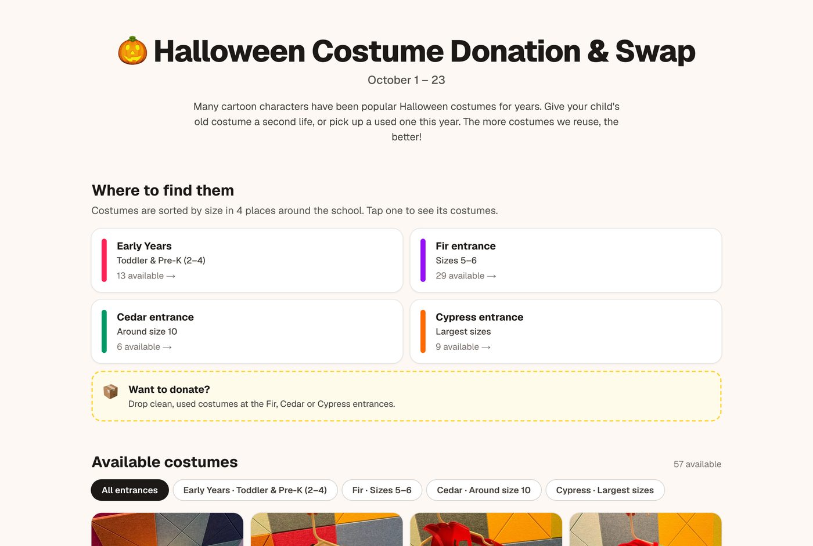
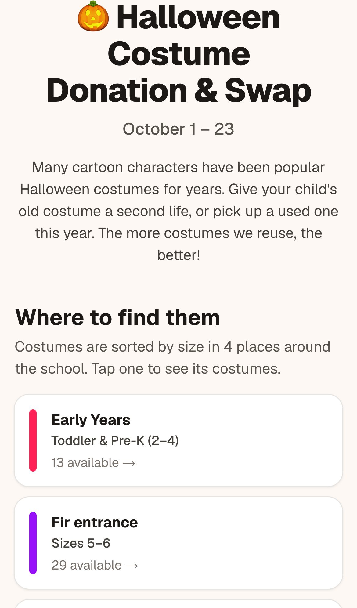
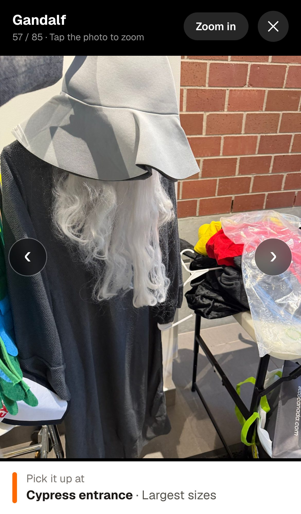
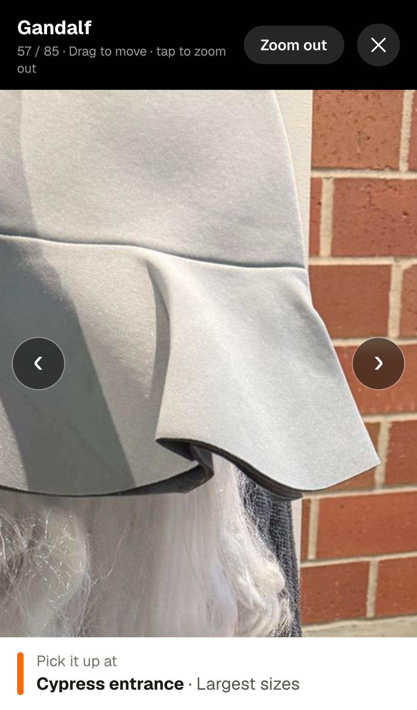
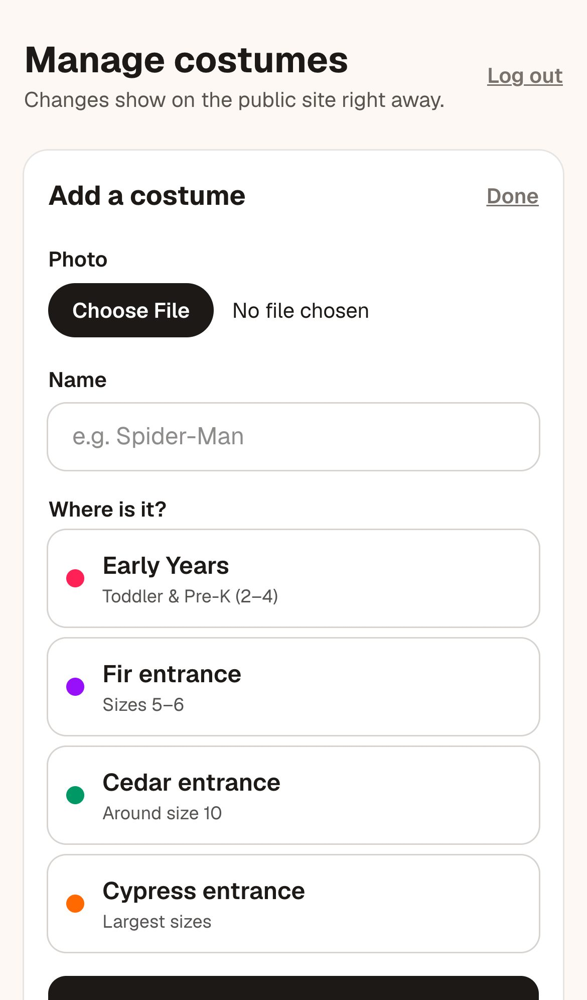
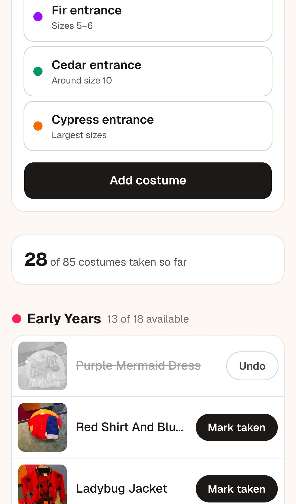

# 🎃 Halloween Costume Donation & Swap

A website that helped families at my child's school **donate, find and reuse Halloween costumes**, so outgrown costumes got a second life instead of ending up in the trash.

**Live:** [costume-swap.vercel.app](https://costume-swap.vercel.app)



## Why

Every year kids outgrow costumes that were worn only once or twice. The school's parent volunteer group organized a costume donation and swap to **promote environmental sustainability**: encouraging reuse, reducing waste and extending the life of costumes.

The swap worked physically: donated costumes were sorted by size and hung at four entrances of the school. The challenge was that families didn't know **what was available or where to find it** unless they walked around the building.

## My role

I volunteered for the project and **took the initiative to build this website** to help reach that goal by:

- **Giving visibility to the options and their location.** Every costume has a photo, a name, and the entrance (and size range) where it can be picked up.
- **Supporting sharing through school communications and social networks.** A single link families could open from parent chats and newsletters, designed phone-first.
- **Measuring data.** A private visit counter to understand the project's reach.

## Impact

In **less than 3 weeks** online (October 10–23, 2026):

| | |
|---|---|
| Visits during the swap | **199** |
| Unique visitors (total) | **150** |
| Costumes, capes and props listed | **85** |
| Marked as taken by volunteers | **28+** |

Visits peaked on the days the link was shared with families (56 on Oct 13, 37 on Oct 15, 51 on Oct 21). Volunteer visits are excluded from the count, and "taken" only includes costumes volunteers marked, so actual reuse was likely higher.

## Features

**For families**
- Costumes grouped by entrance and size, with live "available" counts
- Full-screen photo viewer with tap-to-zoom and swipe/arrow navigation between costumes
- Taken costumes stay visible but grayed out, so families can see the reuse happening

**For volunteers** (password-protected `/admin`)
- Mark costumes as taken (or undo) from a phone, reflected on the site instantly
- Add a new costume from the phone camera: photo, name and entrance
- Total taken count and a private visit dashboard (daily visits and unique visitors)

| Entrances (mobile) | Photo viewer | Zoom |
|---|---|---|
|  |  |  |

| Volunteer: add a costume | Volunteer: mark as taken |
|---|---|
|  |  |

## Privacy and security decisions

Because this is a school community site, I treated privacy and safety as requirements, not extras:

- **No location data in photos:** every photo is resized and re-encoded, on the phone and again on the server, which removes GPS and other metadata.
- **Uploads are verified on the server:** anything that isn't a real image is rejected.
- **Rate-limited volunteer login** to prevent password guessing, plus standard security headers (no framing, no MIME sniffing).
- **Private, anonymous analytics:** the visit counter stores no personal data, only a random per-browser id to count unique visitors.
- **Stays up if the database fails:** the public page still shows every costume.

## Tech stack

- [Next.js 16](https://nextjs.org) (App Router, Server Actions, Cache Components) with React 19 and TypeScript
- [Tailwind CSS 4](https://tailwindcss.com)
- [Vercel](https://vercel.com) for hosting and [Vercel Blob](https://vercel.com/docs/vercel-blob) for uploaded photos
- [Upstash Redis](https://upstash.com) for taken costumes, uploads, visit counts and rate limiting
- [sharp](https://sharp.pixelplumbing.com) for server-side image processing

Built with AI assistance ([Claude Code](https://claude.com/claude-code)): I defined the problem, the flows and the decisions; AI helped me implement them quickly.

## Running locally

```bash
npm install
npm run dev
```

Environment variables (see Vercel project settings):

| Variable | Purpose |
|---|---|
| `ADMIN_PASSWORD` | Volunteer password for `/admin` |
| `KV_REST_API_URL`, `KV_REST_API_TOKEN` | Upstash Redis |
| `BLOB_READ_WRITE_TOKEN` | Vercel Blob (photos uploaded from `/admin`) |

Costume photos live in `public/costumes/<entrance>/`; the file name becomes the costume's name. Entrances, sizes and site text are in `src/config.ts`.

---

Made by Luisa Guzman as a parent volunteer.
